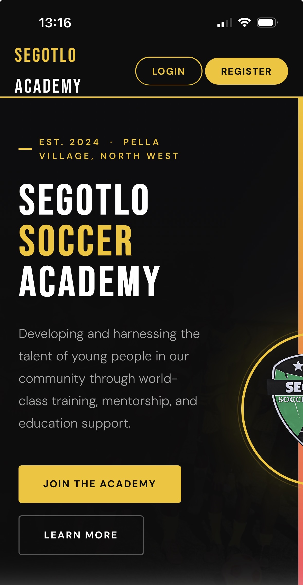
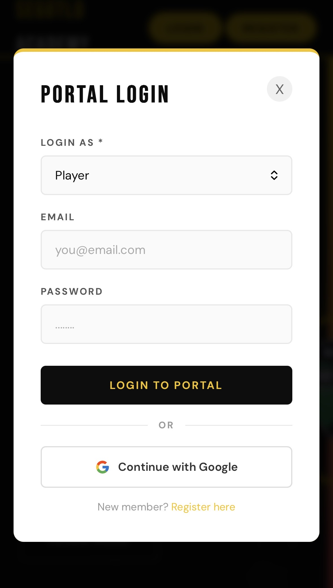
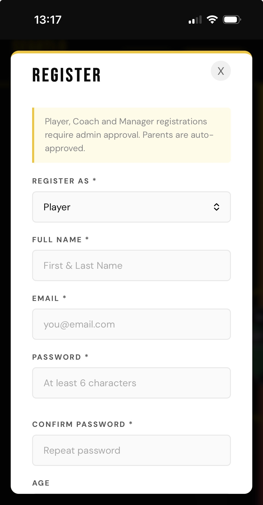
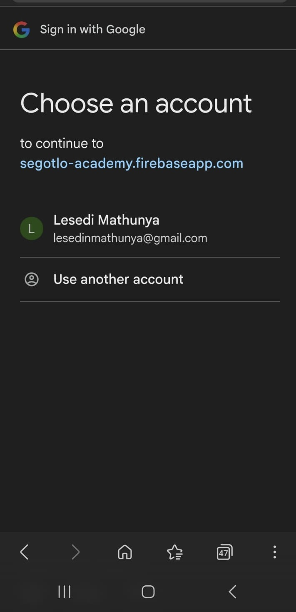
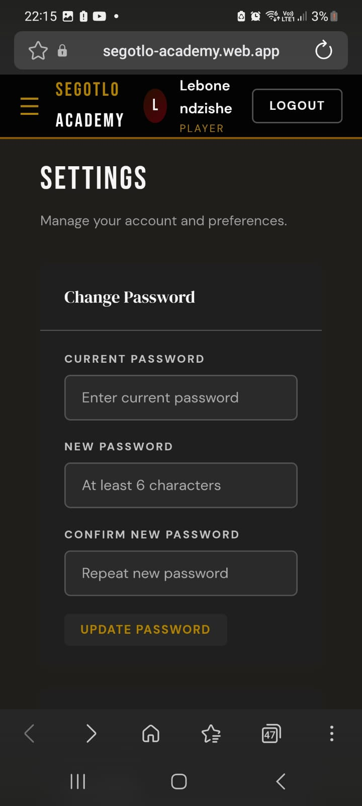
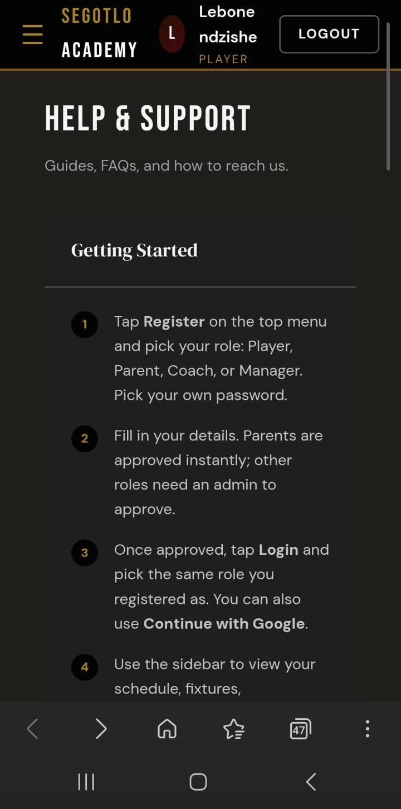

 
<h1 align="center">Segotlo Soccer Academy</h1>
<h3 align="center">Soccer Academy Management System – Android Application</h3>

  Supporting the management and development of Segotlo Soccer Academy.

  
  
  

---

## About the App

The Segotlo Soccer Academy Management System is an Android application developed to support the administrative activities and development of Segotlo Soccer Academy. The application provides a centralised digital platform through which users can access relevant academy information and available management functionality using their mobile devices.

The system aims to improve the organisation, accessibility and management of academy-related information. It uses Firebase as its backend service, with Firebase Authentication supporting user authentication and Firebase Realtime Database providing cloud-based data storage and retrieval.

The Android application also shares its backend with the academy's website, allowing information managed through the connected platforms to remain synchronised.

## Project Links

  
    
  

- **Source Code:** https://github.com/ST10448358/Segotlo.git
- **Demonstration Video:** https://drive.google.com/file/d/1ocbxQuUi236sCPy3MdfuD5v3ojnn5ub4/view?usp=sharing

## Application Screenshots

The following screenshots demonstrate the Android application's interface, navigation and implemented functionality.

<!-- Replace the image paths below with the actual names of your screenshots. -->

  
  
  

  
  
  

## Purpose of the Application

The primary purpose of the application is to provide a convenient mobile platform for accessing and managing information associated with Segotlo Soccer Academy.

The application addresses the need for a more organised digital approach to academy administration by making relevant functionality accessible through an Android device. It also supports improved information accessibility through its Firebase backend and connection to the academy's website.

By providing authentication, account management and access to academy-related functionality, the system aims to make interactions with the academy more convenient and support its day-to-day administrative activities.

## Design Considerations

The application was designed with usability, accessibility, simplicity and consistency in mind.

- **User-friendly navigation:** The interface is organised to help users locate and access available functionality without unnecessary complexity.
- **Consistency:** Consistent layouts, readable text, icons and navigation elements help create a familiar experience throughout the application.
- **Accessibility:** The interface aims to make important information and functions easy to identify and access.
- **Account security:** Firebase Authentication is used to support secure user authentication, while account-related functionality allows users to manage their information.
- **Role-based functionality:** The system considers the different responsibilities of users within the academy and provides access to relevant functionality.
- **Data integration:** Firebase Realtime Database was selected to support cloud-based data storage and retrieval. Sharing the backend with the website also supports information consistency across the two platforms.

These considerations guided the development of an application that is practical, organised and suitable for the academy's needs.

## Key Features

- User registration and login.
- Google Single Sign-On (SSO).
- User authentication through Firebase Authentication.
- Profile and account management.
- Updating personal information and account settings.
- Password management.
- Help and support functionality.
- Firebase Realtime Database integration.
- Shared backend integration with the academy website.

## Technologies Used

| Technology | Purpose |
|---|---|
| Android Studio | Android application development |
| Kotlin | Application programming language |
| Firebase Authentication | User authentication and account access |
| Firebase Realtime Database | Cloud-based data storage and retrieval |
| Google Sign-In | Single Sign-On functionality |
| GitHub | Source-code hosting and version control |
| GitHub Actions | Continuous integration and workflow automation |

## GitHub and Version Control

GitHub was used as the central platform for hosting and managing the Android application's source code. The repository allowed the development team to maintain the project files, track changes and manage updates throughout the development process.

Version control supported collaboration by providing a shared location for the project code and maintaining a history of changes. Commits helped record development progress and made it easier to identify updates made to the application.

The project repository contains the Android application source code and provides access to the files required to review the implementation.

## GitHub Actions and Continuous Integration

GitHub Actions was used as part of the project's DevOps approach to support continuous integration and automate development activities.

Workflow automation provides a way to trigger development tasks when changes are pushed to the repository or when pull requests are created. This supports a more organised development process by allowing builds and automated tests to be incorporated into the workflow.

The use of GitHub Actions also supports the identification of potential build or testing issues during development, helping the team assess changes before they are integrated into the project.

Workflow configuration and execution evidence can be reviewed under the **Actions** tab in the GitHub repository.

## Release Notes

The release notes document the improvements and additional functionality introduced as the application progressed from its initial prototype to the Task 2 version.

### Version 1.0.0 – Task 2 Update

**Release overview:** This version builds on the initial application prototype by improving account functionality, authentication and integration with the academy's backend services.

**Enhancements and features:**

- **Google Single Sign-On:** Google sign-in functionality was incorporated to provide users with an additional authentication option.
- **Account and profile management:** Users can access account-related functionality and manage their personal information.
- **Settings and password management:** Account settings and password-related functionality were included to support user account management.
- **Help and support:** Help and support functionality was incorporated to provide users with a way to access assistance.
- **Firebase integration:** Firebase Authentication and Firebase Realtime Database support authentication and the storage and retrieval of application information.
- **Website and mobile application integration:** The Android application uses the same backend as the academy website, supporting access to shared information across the platforms.

**Release outcome:** The Task 2 version extends the original prototype by providing additional account functionality and strengthening the integration between the mobile application and the academy's backend services.

## Future Improvements

Possible future improvements include expanding the application's functionality, improving the user experience, strengthening testing and quality assurance, and preparing the application for distribution through the Google Play Store.

These improvements would support the continued development and long-term use of the Segotlo Soccer Academy Management System.
